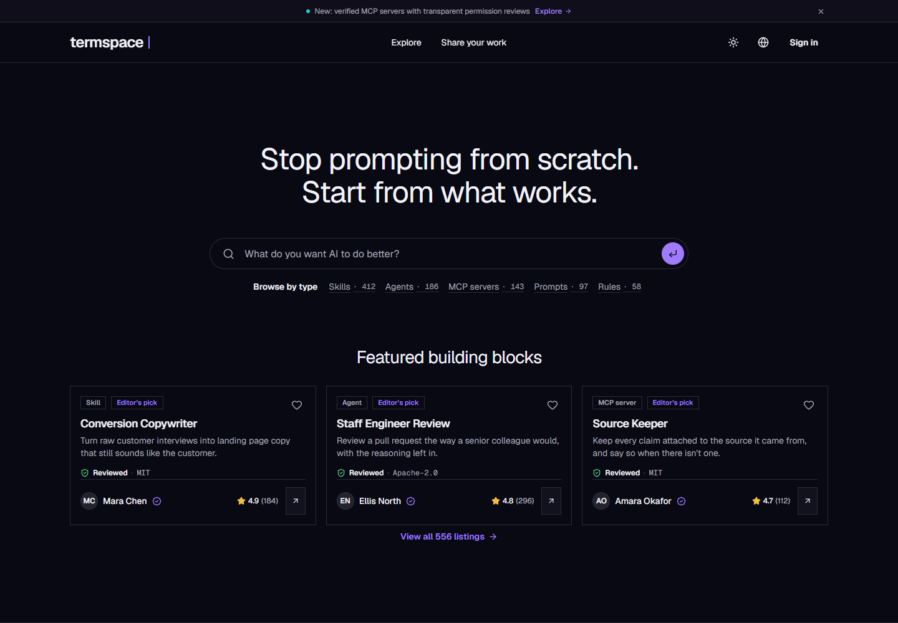
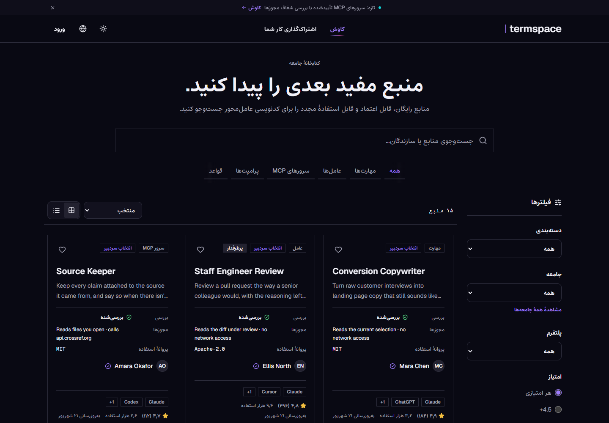

# TermSpace

An English/Persian community library for agentic coding tools. Discover skills,
agents, MCP servers, prompts and workflows; inspect their declared access and
source before adding a pinned release to your library.

**Status:** implemented platform with launch work still open. Resources are free;
paid checkout and creator payouts are not implemented. This is a collaborative
project; [contributors and history](https://github.com/boyInShadows/termSpace/graphs/contributors)
retain attribution. **Ramtin Farzane's contribution:** web presentation, landing
page and dashboard shell (confirmed by Ramtin).

[Run locally](docs/development.md#local-development) |
[Verification](docs/development.md#verification) |
[Deployment](docs/development.md#production-subdomain-deployment) |
[Product direction](docs/product-direction.md) | [Open work](pending.md)





Actual production-build captures with the repository's synthetic mock catalog.
Names, ratings and listing counts are example data; these images do not establish
live users, provider verification or production deployment.

## Implemented journeys

- Browse and search the bilingual catalog by type, community and platform, with
  Persian RTL, themes, listing details and public creator profiles.
- Create owner-scoped drafts, manage immutable release snapshots and submit them
  to a role-gated moderation workspace with audit events.
- Acquire a free, approved release, view its pinned installation information and
  submit acquisition-backed ratings/reviews from a verified account.
- Publish editorial content in the separate staff-managed Blog. Marketplace
  creator/moderator roles do not grant Blog publishing access.

The first milestone references external GitHub/npm sources rather than executing
uploaded community packages. Source ingestion and free acquisition are implemented;
real provider credentials and workers are required for those flows. The current
[launch queue](pending.md) covers notification preferences, Studio onboarding and
feedback, moderation notifications, real email delivery, Redis limiter startup
reliability and final signed-in acceptance. Those items remain open.
Detailed operations remain in [development and deployment](docs/development.md).

## Start here

Requires Node.js 22+, npm and PostgreSQL (Docker Compose is supported).

```bash
git clone https://github.com/boyInShadows/termSpace.git
cd termSpace
npm ci
npm run prisma:generate
```

Then follow [environment, database and startup steps](docs/development.md#local-development).
Copying the templates alone is insufficient: align database settings and supply
runtime secrets. The web app runs on `3000`, Blog on `3001`, and API on `4001`.
The browser-test fixture can run without PostgreSQL; it does not verify real provider flows.

## Code map

| Path | Responsibility |
| --- | --- |
| `apps/web` | Next.js community catalog, reader dashboard and creator interface |
| `apps/blog` | Separate Next.js editorial publication |
| `apps/api` | Express API, authentication, authorization, Prisma and PostgreSQL |
| `docs` | Product boundaries, architecture and operational guides |

The API hashes stored session tokens, checks expiry and explicit marketplace roles,
and keeps creator operations owner-scoped. These are inspected boundaries, not a
complete security-audit claim. See [creator ownership](docs/creator-onboarding.md)
and [role operations](docs/marketplace-roles.md).

## Verification

Use the [documented checks](docs/development.md#verification) and inspect the
[CI](.github/workflows/ci.yml) and [browser/performance runs](.github/workflows/web.yml).
The 2026-10-30 review started from public source `4701126`. After the bounded
serializer typing change, type-checks, 779 tests, web lint (two existing warnings)
and all three builds passed, including tests on a fresh migrated PostgreSQL 16
database. One Redis integration case was skipped without Redis. A focused browser pass
completed 90 checks with six intentional device-specific skips using the mock API.

Production email/source-provider access, real device acceptance and launch readiness
remain separate from these local checks. [Changelog](changelog.md) records scoped
changes and verification.
