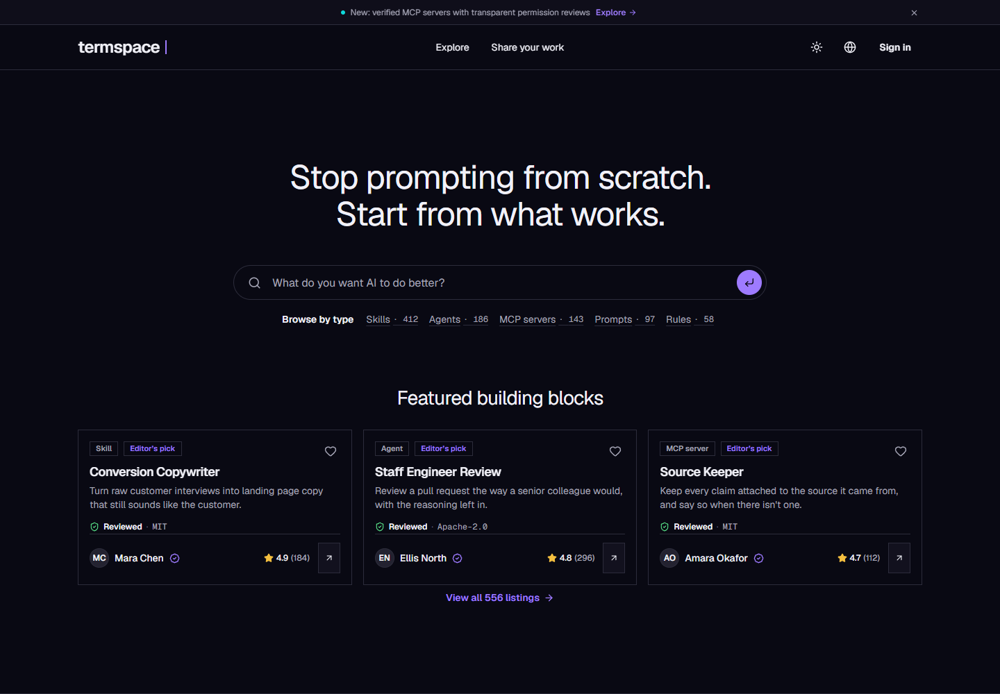
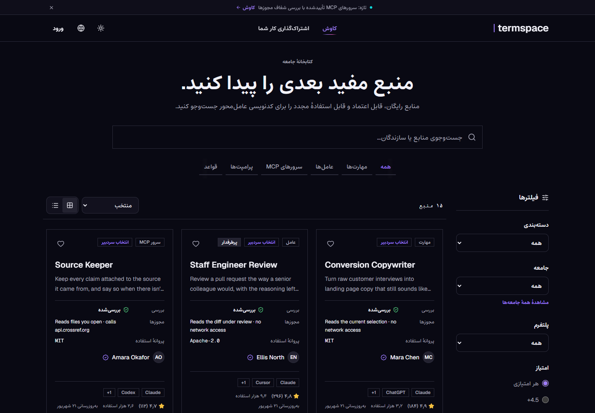

# TermSpace

TermSpace is a free, bilingual marketplace for agentic coding tools. Discover
skills, agents, MCP servers, prompts, rules, hooks, and workflows in English or
Persian. Check what a tool can access, where its release comes from, and whether
it fits your platform before you install it.

[Marketplace](https://termspace.dev) ·
[Local setup](docs/development.md#local-development) ·
[Deployment](docs/development.md#production-subdomain-deployment) ·
[Contributing](docs/CONTRIBUTING.md) ·
[Changelog](changelog.md) ·
[Open work](pending.md)

## What you can do

- **Discover and install.** Search by item type, community, or compatible
  platform. Inspect a release's source, declared permissions, and installation
  instructions. You can install a published release without an account.
- **Build your library.** Sign in to save favorites and add pinned releases to
  your library. Verified users can rate and review releases they've added.
- **Publish as a creator.** Manage a public profile, draft listings, verify
  GitHub or npm sources, and submit releases for review from Creator Studio.
- **Get support or report a listing.** Readers can report a listing from its
  detail page and open private text support tickets in the dashboard. Staff
  have a role-gated inbox and moderation queues for submissions, reports,
  and reviews.
- **Read the TermSpace Blog.** The editorial app publishes articles, series,
  editions, and resources. Its publishing tools are reserved for editorial staff.

Every listing is free. Published releases pin an external artifact from GitHub
or npm. TermSpace presents source and permission information and leaves
installation to the reader's environment. [Product direction](docs/product-direction.md)

## Repository map

| Path | Role | Local URL |
| --- | --- | --- |
| `apps/web` | Next.js marketplace, reader dashboard, Creator Studio, and moderation | [localhost:3000](http://localhost:3000) |
| `apps/blog` | Next.js editorial publication and staff publishing tools | [localhost:3001](http://localhost:3001) |
| `apps/api` | Express REST API with Prisma and PostgreSQL | [API health](http://localhost:4001/api/health) |
| `shared/analytics` | Cookie consent and public-page measurement for both frontends | |
| `deploy/` | VPS deployment and support-widget operations | |
| `docs/` | Product direction, architecture decisions, and operational guides | |

Both frontends share reader accounts through the API. Reader sessions use
host-only cookies, and editorial permissions are separate from marketplace
creator and moderator roles. Redis supports rate limiting. Compose also runs
workers for verification email, source checks, and scheduled Blog publication.
[Architecture decisions](docs/architecture)

## Run locally

Use Node.js 22 or newer, npm, Docker, and Docker Compose.

```sh
git clone https://github.com/boyInShadows/termSpace.git
cd termSpace
npm ci
npm run prisma:generate
```

Copy the environment templates and match the API's database URL to the
Compose database credentials and host port. [Environment setup](docs/development.md#local-development)

```sh
npm run db:up
npm run prisma:deploy
```

Start each app in its own terminal with `npm run dev:api`, `npm run dev:web`,
or `npm run dev:blog`. Persian pages use the `/fa` prefix and right-to-left
layouts. Demo data is opt-in via `npm run seed`. To run all services together,
follow the [Docker Compose guide](docs/development.md#run-the-complete-stack-with-docker).

## Checks and deployment

```sh
npm run typecheck
npm test
npm run lint -w apps/web
npm run build
```

CI also runs database-backed API tests. Playwright and Lighthouse use a mock
API and cover web behavior and performance. The changelog records scoped test
results, and the launch queue records open work.
[Verification guide](docs/development.md#verification) ·
[CI](.github/workflows/ci.yml) ·
[Web checks](.github/workflows/web.yml)

The VPS deployer waits for CI to pass on `main` before deploying the marketplace
and API. The Blog has a separate release process. Production email and source
verification require provider credentials and their corresponding workers.
[Automatic deployment](docs/development.md#automatic-deployment) ·
[Worker setup](docs/development.md#accounts-and-background-workers)

### Optional analytics

Each frontend has independent English and Persian cookie controls. GA4 loads
after opt-in and measures public page views on both sites, plus listing clicks
and successful install-command copies on the marketplace. Visitors can withdraw
consent in **Cookie settings** in either footer. Analytics stays off on each
site until its GA4 measurement ID is configured. [GA4 setup](docs/development.md#cookie-consent-and-google-analytics)

## Screenshots

Production-build screenshots from the local mock catalog show the homepage and
Persian discovery view with example listings and ratings.





## Contributors

Ramtin Farzane contributed the web presentation, landing page, and dashboard shell.
[Contributors and history](https://github.com/boyInShadows/termSpace/graphs/contributors)
